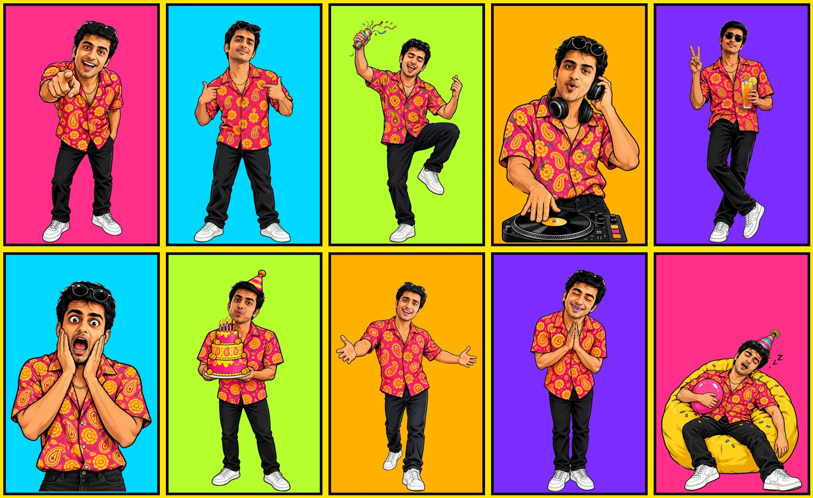

# 01 · Birthday house-party invite (46 s)

<p>
  
</p>

▶️ **[invite.mp4](invite.mp4)**: the generic version, ending on "HEY YOU!"
▶️ **[invite-personalised-demo.mp4](invite-personalised-demo.mp4)**: the same video with a per-guest ending (name + photo)
🖼️ **[personal-card.jpg](personal-card.jpg)**: the still card rendered for each guest (for WhatsApp)

## The brief (as the user typed it)
> cool edit motion graphics song video, funky pop desi maximalism vibe … for my birthday invitation … house party … use upload song background music main part only … at the end personalised photo invitation for everybody that can be templatised. Address – Carlton Estate 4, Tower C, C65. Reach 8 onwards and before also works like a funny … cool genz comedic funny video funky colours pop.

Follow-up requests during the session: change the name to ARSHABH, use a different photo in the reveal, dress code "Kapde", remove "gifts optional", then make it **family friendly** (no alcohol or smoking props).

## Characters (Atlabs MCP · GPT Image 2.5 · ~0.8 credits each)


All poses came from two reference photos plus one fixed outfit line: *hot-pink marigold-paisley shirt, gold chain, black jeans, white sneakers, sunglasses on head*. The two props were later swapped (beer → party popper, cigarette and whisky → peace sign and mocktail) with `nano_banana_pro` edits.

## Music
*"Aww Tera Happy Bday"* (ABCD 2) runs at **150 BPM** (0.4 s beat, 1.6 s bar). The slice used is 1.74 s → 48.14 s of the track, and the drop lands at video 14.4 s.

## Scene breakdown
| Video time | Lyric / music | Scene |
|---|---|---|
| 0.0–0.9 | intro | TV static, "🚨 BREAKING 🚨 / GUEST LIST LEAKED!!" |
| 0.9–7.4 | *"main, tu, mera yaar, tere friends, teri GF, tera ex, teri GF ka ex"* | Guest list: one tape strip per sung word, background colour changes per word, character swaps (thumbs-at-self → pointing at you → dancing → shocked), "SAB INVITED!" stamp |
| 7.4–10.8 | build | "kyunki…" + giant name + real photo cutout with crown + "(official photo 😏)" + "KA BIRTHDAY HAI!!!" |
| 10.8–14.4 | build | "PARTY LOADING…" bar (charging speakers 37%, ironing kapde 68%, cleaning the house 99%) then a 3-2-1 countdown on the last beats |
| 14.4–17.6 | **drop** *"Happy birthday"* | HAPPY / BDAY!!, dancing cutout flipping each beat, marigolds, bunting, confetti, हैप्पी बर्थडे |
| 17.6–20.8 | chorus | Neon "HOUSE PARTY", disco ball, "DRESS CODE: KAPDE (haan, seriously)" |
| 20.8–24.0 | chorus | "TONIGHT'S MENU (100% mummy approved)": a card per beat |
| 24.0–27.2 | *"pajama pakad ke naach"* | Three dancing clones, colour strobe, "NAACHNA COMPULSORY" |
| 27.2–30.4 | *"tere bhai ka birthday"* | Swag pose with sunglasses glint, "HORN OK PLEASE" truck sign |
| 30.4–33.6 | verse | Cake pose, "CAKE ✅", "ATTENDANCE: COMPULSORY!!" |
| 33.6–38.4 | verse | KAHAN? address card with a pin drop, KAB? 8 PM ONWARDS + *pehle aa gaye toh bhi chalega*, a rickshaw driving across |
| 38.4–39.6 | *"aaj mera birthday"* | आज मेरा BIRTHDAY!! |
| 39.6–46.4 | chorus 2 | **Personal card**: HEY {NAME}!, guest photo polaroid, welcoming pose, YOU'RE INVITED!, address/time card |

## Per-guest rendering
```bash
node tools/render-guests.mjs   # reads guests.json: [{ "name": "Rahul", "photo": "/path/rahul.jpg" }, …]
```
The first 39.6 s render once. Each guest then takes about 30 s and gets `out/guests/<name>.mp4` + `<name>.png`.
