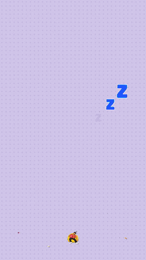

# 02 · Thank you for coming (12 s)

▶️ **[thank-you.mp4](thank-you.mp4)**

## The brief
> now the party is done, everyone is gone, I want to create a short video around 10 sec, saying Thank you for coming, Hope you have enjoyed last night :) and next bhi aaoge — like this vibe, cool motion graphics video

The song changed twice during the session: a slice of the birthday song first, then Daft Punk's *One More Time*, and finally Britney Spears' *...Baby One More Time*. Each time the whole timeline re-synced to the new beat grid, because the scene boundaries are written in beats.

## Music
*"...Baby One More Time"* runs at **93.02 BPM** (0.645 s beat). The slice is 67.77 s → 80.03 s of the track (19 beats). The first 3 beats are low-pass filtered ("muffled"), then the track opens up at the THANK YOU slam.

## Scene breakdown
| Beats | Lyric | Scene |
|---|---|---|
| 0–3 | (muffled) | **Morning after**: lavender room, sleeping pose on a bean bag, floating Zzz, typed "agli subah…", "⏰ 11:47 AM" |
| 3–8 | *"And I'm not with you, I lose my mind"* | **THANK / YOU!! / FOR COMING 🙏**, namaste pose, धन्यवाद, confetti |
| 8–12 | *"Give me a sign"* | **"hope you enjoyed LAST NIGHT :)"**, three polaroids (bhangra king · DJ · cake time) drop on beats, "KYA RAAT THI YAAR 🔥" |
| 12–19 | *"Hit me baby one more time"* | **"NEXT BHI AAOGE NA?"**. The NAHI button runs away from the cursor twice ("nope!"), and the cursor clicks **HAAN on "one more time"**. Then confetti and "love, {host}" |

## New poses for this video
`sleepy` (bean bag, party hat, hugging a balloon) and `namaste`, both generated with the same outfit line as example 01.
